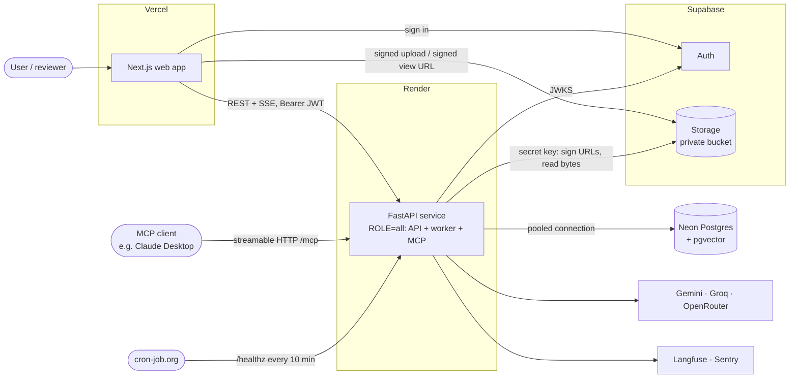
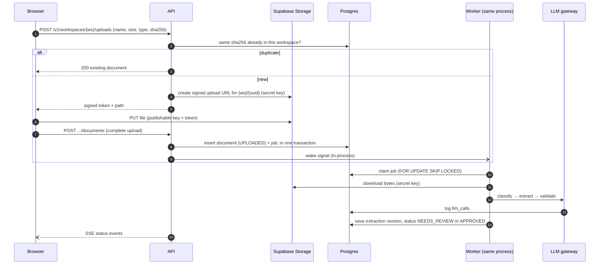

# 000: Architecture overview

**Status:** Approved (2026-10-24)
**Related:** [constitution](../constitution.md) · [ADRs](adr/) · [Phase 0 tasks](phase-0-tasks.md)

## 1. Purpose

DocFlow turns uploaded invoices, receipts and purchase orders into validated, structured data:

- It **classifies** each document, **extracts** fields with a vision LLM, **validates** them with a tool-using agent, sends low-confidence fields to a **human reviewer**, and **exports** approved data.
- Users can **search** their documents in natural language and query them from AI assistants over **MCP**.

The system runs entirely on free tiers. The design goals, in priority order:

1. Correct and isolated: no data leaks between workspaces.
2. Easy to explain: every decision can be defended in an interview.
3. Measurable: accuracy, cost, latency and the share of documents approved without edits are tracked from the start.
4. Cheap to run: it stays inside the free tiers.

## 2. System context



## 3. Components

| Component | Responsibility | Notes |
|---|---|---|
| **Web** (`apps/web`) | Sign-in, upload, document list and detail, review, search, metrics | Calls the API with the user's Supabase access token as a Bearer token. Shows document previews from short-lived signed URLs served by Supabase, never streamed through the API. |
| **API** (`apps/api`, `app/api`) | REST endpoints, SSE status stream, authentication, workspace scoping | Thin routers that call services. |
| **Worker** (`app/worker`) | Claims jobs from Postgres and runs `classify → extract → validate` | Runs in the same process as the API when `ROLE=all`. See §5. |
| **LLM gateway** (`app/llm`) | One interface over all providers: routing per task, fallback, circuit breaker, cache, logging to `llm_calls` | The only code allowed to call LLM providers. |
| **MCP server** (`app/mcp`) | `search_documents`, `get_document`, `list_vendors`, `spend_summary` | Mounted at `/mcp`. Authentication is decided in F12. |
| **Postgres** (Neon) | All metadata, versioned extraction JSONB, the job queue, embeddings, LLM call logs, eval runs | Stores no file bytes. |
| **Storage** (Supabase) | Original files in the private `documents` bucket | No storage access policies; only the backend can grant access. |
| **Auth** (Supabase) | Users and sessions, and issuing JWTs | The backend verifies JWTs against the project's JWKS endpoint. |

### Backend module layout

```
apps/api/app/
├─ main.py            # create_app(settings): wires the routers and lifespan according to ROLE
├─ __main__.py        # `python -m app`: starts uvicorn (api/all) or the worker loop (worker)
├─ core/              # config, logging, errors (problem+json), db engine and sessions, request id
├─ auth/              # JWT verification, JWKS cache, CurrentUser dependency
├─ identity/          # users, workspaces, memberships, provisioning, /v1/me (F1)
├─ documents/         # F2
├─ jobs/  worker/     # F3: queue repository, claim loop, retry and backoff
├─ pipeline/          # F4–F6: classify, extract, validate steps
├─ llm/               # F10: gateway, providers/, prompts/<task>/v<N>.md, cost table
├─ search/  export/  mcp/  metrics/
└─ generated/         # created by datamodel-code-generator from schemas/; never edited by hand
```

Each feature module contains `routes.py`, `service.py`, `repository.py`, `models.py` and `schemas.py`. Modules may import from `core` and `auth`. Imports between feature modules go through a module's `service.py` only. This rule is what keeps a later split into separate services cheap.

## 4. Data flow (end to end)



The full upload contract is designed in F2 and the queue in F3. This diagram fixes only the overall shape.

## 5. Process roles (`ROLE`)

| ROLE | HTTP server | Worker loop | Used where |
|---|---|---|---|
| `api` | yes | no | A future split deployment |
| `worker` | no | yes | A future split deployment |
| `all` | yes | yes, as a task inside the app's lifespan | Render free tier (today), local development |

Both roles are built by the same `create_app` and settings, so splitting them later is a configuration change, not a code change.

**How the worker wakes up (the detail is designed in F3, the constraint is fixed here):**

- When the worker runs in the same process as the API, the API signals it in memory after committing a new job.
- While idle, the worker sleeps until the earliest `run_after` of a pending retry, or until a slow sweep interval of **15 minutes or more** has passed, whichever is sooner.
- It does **not** poll every few seconds. Neon compute suspends after 5 minutes without queries, and the free plan has only 100 compute-unit-hours a month. A 2-second poll would keep Neon awake permanently: about 180 CU-hours a month even at the smallest 0.25 CU size.
- `LISTEN/NOTIFY` is not available through Neon's transaction-mode pooler, so it is not used.

## 6. Multi-tenancy model

- `workspaces` is the tenant root. `users` are global, linked to the Supabase Auth subject. `memberships(workspace_id, user_id, role)` has roles `admin` and `reviewer`.
- Tenant-scoped URLs: `/v1/workspaces/{workspace_id}/...`. A dependency resolves the caller's membership and returns a `WorkspaceScope`, which every repository for tenant data requires (constitution §4).
- Isolation is enforced at the application layer now. Postgres row-level security as a second layer is considered in F14 ([open question](#13-open-questions) A3).

## 7. Environments

| | Local | CI | Preview | Production |
|---|---|---|---|---|
| Web | `localhost:3000` (`pnpm dev`) | build + Vitest | Vercel preview per PR | Vercel production |
| API | `localhost:8000` (`uv run`), `ROLE=all` | pytest | none; previews call the production API (A1) | Render free web service |
| Postgres | Docker `pgvector/pgvector:pg17` (A2) | service container, same image | production | Neon `main` branch, pooled connection |
| Storage | Supabase project, bucket `documents-dev` (A4) | faked | production bucket | Supabase bucket `documents` |
| Auth | Supabase project (shared) | locally generated test keys | Supabase project | Supabase project |
| LLMs | real free tiers, with your own keys | fake provider | n/a | real free tiers |

The **Neon `dev` branch** is used to rehearse migrations against real Neon before a production deploy (see A2).

### Regions

All services go in **Singapore**: Render `singapore`, Neon `aws-ap-southeast-1` and Supabase `ap-southeast-1`. That keeps the API, database and storage close to each other and to users in India. (Supabase also offers Mumbai, but Neon and Render don't, and the API-to-database hop matters most.) See A5.

## 8. Platform limits (checked 2026-10-24)

| Platform | What the brief says | What I found | Effect on the design |
|---|---|---|---|
| Render free | Sleeps after about 15 min; 30–60 s cold start; about 512 MB; no workers; ephemeral disk | Confirmed: 15 min, **512 MB RAM and 0.1 CPU**, ephemeral disk. **Waking takes about 1 minute**, per Render's docs. 750 instance hours a month per workspace. **No pre-deploy command on free instances.** Since the plan change on 1 Aug 2026, Hobby workspaces include **5 GB of outbound bandwidth** (down from 100 GB) and 500 build minutes. | 0.1 CPU makes startup slow, so imports stay light and there are no heavy libraries. Migrations run in the start command, as the brief says. Keep-alive pings use about 720 of the 750 hours, so **no other Render free services** (and no preview environments) in this workspace. Files are never proxied through Render, to save bandwidth. The UI tolerates cold starts of up to 90 s. |
| Neon free | 0.5 GB; suspends when idle | Confirmed: 0.5 GB per project, **100 CU-hours per month per project**, suspends after 5 min idle (can't be turned off), 10 branches, 5 GB transfer. | Worker idle behavior (§5). `/healthz` never touches the database. Embeddings use a reduced dimension (decided in F8). Two connection strings are needed: pooled for the app, direct for migrations. |
| Supabase free | 1 GB storage; 50 MB file max; pauses after 7 days | Confirmed: 1 GB, 50 MB global maximum (bucket limits can be lower), pauses after 1 week inactive, 2 active projects, 50k MAU. **The built-in email sender only delivers to members of your Supabase organization, at 2 emails an hour.** | **Email confirmation, magic links and password reset don't work for outside users without custom SMTP.** This shapes the F1 sign-in method (see F1, Q1). The weekly keep-alive request stays. |
| Supabase JWTs | Verify via JWKS | New projects issue **asymmetric** JWTs (RS256 or ES256) published at `/auth/v1/.well-known/jwks.json`. The legacy HS256 secret is "no longer recommended". The `anon` and `service_role` keys are being retired by the end of 2026 in favour of `sb_publishable_…` and `sb_secret_…` keys. | The verifier accepts only ES256 and RS256. A manual step confirms the project uses asymmetric signing keys. The new key names are used everywhere. |
| Gemini free | Use for extraction and embeddings | Free-tier limits are shown **only in AI Studio**, per project; third-party figures disagree. Free-tier data **may be used to improve Google's products** (consistent with the brief). Gemini 2.0 Flash models shut down 1 Jun 2026. **Gemini 2.5 is only available to accounts that used it before**; new projects should use the 3.x Flash / Flash-Lite models. `text-embedding-004` is gone; use `gemini-embedding-001` or `gemini-embedding-2`. | Model IDs are config. In Phase 1 we read the real limits from AI Studio and record them. |
| Groq free | Classification and the agent | No card needed. Limits are **per model and per day** (for example about 1,000 requests a day on 70B-class models), applied per organization. | Fine for classification and the agent at portfolio volume. |
| OpenRouter `:free` | Fallback | 20 requests a minute, and **only 50 requests a day** unless the account has ever bought $10 of credit. | It works as a last-resort fallback, but 50 a day is too few to use OpenRouter for evals. Evals use Gemini and Groq. See A6. |

Library versions checked on the same date: FastAPI 0.162, Pydantic 2.14, **SQLAlchemy 2.1** (the brief says 2.0; 2.1 is compatible), Alembic 1.20, psycopg 3.3, **MCP Python SDK 2.3** (a major version newer than most tutorials, so the FastMCP API is re-checked in F12), Next.js 16.4, React 19.3, **TypeScript 7.0** is the newest, but `create-next-app` 16.4 pins **TypeScript 5.9** and ESLint 9, so we keep those until Next.js supports 7, Tailwind 4.3, pnpm 12, Langfuse SDK 5. Exact versions are pinned by the lockfiles when the project is scaffolded.

## 9. Configuration and secrets

| Variable | Used by | Lives on | Secret |
|---|---|---|---|
| `ROLE` | api | Render, local | no |
| `DATABASE_URL` (pooled) | api | Render, local | **yes** |
| `DATABASE_URL_DIRECT` (migrations) | api (Alembic) | Render, local | **yes** |
| `SUPABASE_URL` | api | Render, local | no |
| `SUPABASE_SECRET_KEY` (`sb_secret_…`) | api (Storage) | Render, local | **yes** |
| `SUPABASE_STORAGE_BUCKET` | api | Render, local | no |
| `CORS_ALLOWED_ORIGINS`, `CORS_ALLOWED_ORIGIN_REGEX` | api | Render, local | no |
| `GEMINI_API_KEY`, `GROQ_API_KEY`, `OPENROUTER_API_KEY` | api | Render, local | **yes** |
| `SENTRY_DSN`, `LANGFUSE_*` | api (Phase 5) | Render | **yes** |
| `NEXT_PUBLIC_SUPABASE_URL`, `NEXT_PUBLIC_SUPABASE_PUBLISHABLE_KEY`, `NEXT_PUBLIC_API_BASE_URL` | web | Vercel, local | no (public by design) |

GitHub Actions secrets: none in Phase 0, apart from the optional test-user credentials for the deployed smoke test (F1, Q4). The backend refuses to start if a required variable is missing.

## 10. Cross-cutting conventions

- **Errors:** RFC 9457 problem+json, with a stable `type`, for example `https://docflow.dev/problems/not-found`. The URI is only an identifier and is never fetched.
- **IDs:** UUIDs generated by the database (`gen_random_uuid()`). **Time:** `timestamptz`, UTC, ISO 8601 in the API.
- **Request ID:** taken from the incoming `X-Request-ID` header or generated, echoed in the response, and bound to every log line.
- **Health:** `/healthz` returns `{"status":"ok"}` and checks nothing, so it's used for Render health checks and keep-alive. `/readyz` checks the database with a 5 s timeout, and is used for diagnostics and deploy verification.

## 11. Measurement plan (built in, reported later)

| Metric | Source | First available |
|---|---|---|
| Extraction accuracy, per field and overall | `eval_runs` (labeled dataset) plus `corrections` (production edits) | Phase 2 |
| Cost per document | Sum of `llm_calls.cost_usd` grouped by `document_id` (cost estimated from a versioned price table; $0 actual spend on free tiers) | Phase 1 (calls logged from the first extraction) |
| Latency | `documents` status-transition timestamps (upload → terminal state), plus `llm_calls.latency_ms` | Phase 1 |
| Approved without edits | Documents approved with zero `corrections` rows divided by all approved documents | Phase 3 |

## 12. Interview-relevant trade-offs (one line each; see the ADRs for detail)

- Postgres as the queue: one fewer system, and the job and the document commit in one transaction (ADR-0001).
- Modular monolith: fits one free instance, and boundaries are enforced by module rules (ADR-0002).
- Own LLM gateway: fallback, cost logging and schema handling stay visible and testable (ADR-0003).
- Direct-to-storage upload: file bytes never pass through a 512 MB / 0.1 CPU instance (ADR-0004).
- Versioned JSONB extractions: the schema changes per document type, and history is kept for review and evals (ADR-0005).
- Monorepo: atomic changes across the schema, backend, frontend and generated types (ADR-0006).

## 13. Decisions (formerly open questions, resolved 2026-10-24)

- **A1. Preview environments:** Vercel previews call the production API. CORS allows this project's Vercel preview URL pattern. All data is synthetic.
- **A2. Local database:** Docker Postgres is the everyday local and test database. The Neon `dev` branch is used only to rehearse migrations (`make migrate-neon-dev`).
- **A3. Row-level security:** isolation is enforced in the application now. Postgres RLS is added as defense in depth in F14.
- **A4. Dev storage:** a second bucket, `documents-dev`, in the same Supabase project.
- **A5. Regions:** everything in Singapore (Render `singapore`, Neon `aws-ap-southeast-1`, Supabase `ap-southeast-1`).
- **A6. OpenRouter:** 50 free requests a day is accepted, since OpenRouter is only the last-resort fallback. No credit purchase.
- **A7. Postgres version:** 17 on both Neon and Docker. If Neon defaults to a newer major version when the project is created, match it in `docker-compose.yml` and CI.
- **A8. Licence:** MIT.
