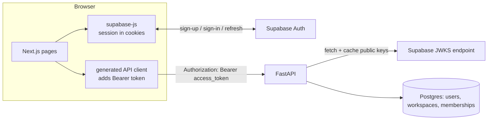

# F1: Auth and workspaces (plan)

**Status:** Approved (2026-10-24)
**Spec:** [spec.md](spec.md) · **Tasks:** [tasks.md](tasks.md)

This plan follows the decisions recorded in the spec: Q1 (email and password, confirmation off), Q2 (workspace in the URL path) and Q5. §9 records what would change under the alternatives.

## 1. Approach



- **The frontend owns the session.**
  - `@supabase/ssr` keeps the Supabase session in cookies on the Vercel domain.
  - Next.js `proxy.ts` (Next 16's replacement for `middleware.ts`) refreshes the session and redirects signed-out visitors away from `/app/**`.
- **The backend is stateless.**
  - Every request carries the Supabase **access token** as a Bearer header.
  - The backend verifies the token's signature against Supabase's **JWKS** (ES256 or RS256), plus its issuer, audience, expiry and role.
  - It never sees passwords or refresh tokens.
- **Why Bearer and not cookies for the API:** the API runs on `*.onrender.com` and the web app on `*.vercel.app`. Cross-site cookies would need `SameSite=None` and CSRF protection, and are blocked by more browsers each year. A Bearer header avoids CSRF entirely, and CORS stays simple (no credentials mode).
- **Provisioning happens lazily, inside the authentication dependency.**
  - The first authenticated request creates the user, their personal workspace and an admin membership, in **one transaction**.
  - Our tables share the Supabase database with `auth.users`, so a trigger on `auth.users` *could* create users. We don't use one (ADR-0007): it would tie our schema to Supabase's internal `auth` schema, and it couldn't be tested on the plain Postgres we use locally and in CI. Lazy provisioning works on any Postgres.

## 2. API contract (OpenAPI fragment)

```yaml
openapi: 3.1.0
paths:
  /v1/me:
    get:
      operationId: getMe
      summary: The current user and their workspaces (provisions on first call)
      security: [{ bearerAuth: [] }]
      responses:
        "200": { content: { application/json: { schema: { $ref: "#/components/schemas/Me" } } } }
        "401": { $ref: "#/components/responses/Unauthenticated" }
        "503": { $ref: "#/components/responses/Unavailable" }
  /v1/workspaces/{workspace_id}:
    parameters:
      - { name: workspace_id, in: path, required: true, schema: { type: string } }  # a malformed id gives 404, not 422 (spec edge case)
    get:
      operationId: getWorkspace
      security: [{ bearerAuth: [] }]
      responses:
        "200": { content: { application/json: { schema: { $ref: "#/components/schemas/Workspace" } } } }
        "401": { $ref: "#/components/responses/Unauthenticated" }
        "404": { $ref: "#/components/responses/NotFound" }
    patch:
      operationId: updateWorkspace
      security: [{ bearerAuth: [] }]
      requestBody:
        required: true
        content: { application/json: { schema: { $ref: "#/components/schemas/WorkspaceUpdate" } } }
      responses:
        "200": { content: { application/json: { schema: { $ref: "#/components/schemas/Workspace" } } } }
        "401": { $ref: "#/components/responses/Unauthenticated" }
        "403": { $ref: "#/components/responses/Forbidden" }
        "404": { $ref: "#/components/responses/NotFound" }
        "422": { $ref: "#/components/responses/ValidationError" }
components:
  securitySchemes:
    bearerAuth: { type: http, scheme: bearer, bearerFormat: JWT }
  schemas:
    Role: { type: string, enum: [admin, reviewer] }
    User:
      type: object
      required: [id, email, display_name]
      properties:
        id: { type: string, format: uuid }
        email: { type: [string, "null"], format: email }
        display_name: { type: [string, "null"] }
    Membership:
      type: object
      required: [workspace, role]
      properties:
        workspace: { $ref: "#/components/schemas/WorkspaceSummary" }
        role: { $ref: "#/components/schemas/Role" }
    WorkspaceSummary:
      type: object
      required: [id, name]
      properties:
        id: { type: string, format: uuid }
        name: { type: string }
    Me:
      type: object
      required: [user, memberships]
      properties:
        user: { $ref: "#/components/schemas/User" }
        memberships: { type: array, items: { $ref: "#/components/schemas/Membership" } }
    Workspace:
      type: object
      required: [id, name, role, created_at]
      properties:
        id: { type: string, format: uuid }
        name: { type: string, minLength: 1, maxLength: 80 }
        role: { $ref: "#/components/schemas/Role" }   # the caller's role
        created_at: { type: string, format: date-time }
    WorkspaceUpdate:
      type: object
      additionalProperties: false
      required: [name]
      properties:
        name: { type: string }   # trimmed on the server, then 1..80 characters
    Problem:   # RFC 9457
      type: object
      required: [type, title, status]
      properties:
        type: { type: string, format: uri }
        title: { type: string }
        status: { type: integer }
        detail: { type: string }
        instance: { type: string }
        request_id: { type: string }
        errors:
          type: array
          items:
            type: object
            required: [field, message]
            properties: { field: { type: string }, message: { type: string } }
```

The responses (`Unauthenticated`, `Forbidden`, `NotFound`, `ValidationError`, `Unavailable`) all use `application/problem+json` with the `Problem` schema. The committed `apps/api/openapi.json` is generated by FastAPI. This fragment is the design target, and a contract test asserts that the generated document matches it.

## 3. Data model (migration `0002_identity`)

All three tables are created in the **`docflow` schema** (ADR-0007), as `docflow.users`, `docflow.workspaces` and `docflow.memberships`. The connection `search_path` makes the unqualified names below resolve there. Supabase's own `auth.users` is a different table, in a different schema.

```sql
CREATE TABLE users (
  id            uuid PRIMARY KEY DEFAULT gen_random_uuid(),
  auth_subject  text NOT NULL,                 -- the Supabase JWT `sub`
  email         text NULL,
  display_name  text NULL,
  created_at    timestamptz NOT NULL DEFAULT now(),
  updated_at    timestamptz NOT NULL DEFAULT now(),
  CONSTRAINT uq_users_auth_subject UNIQUE (auth_subject)
);

CREATE TABLE workspaces (
  id                  uuid PRIMARY KEY DEFAULT gen_random_uuid(),
  name                text NOT NULL,
  created_by_user_id  uuid NOT NULL REFERENCES users(id),
  created_at          timestamptz NOT NULL DEFAULT now(),
  updated_at          timestamptz NOT NULL DEFAULT now(),
  CONSTRAINT ck_workspaces_name_length CHECK (char_length(name) BETWEEN 1 AND 80)
);

CREATE TABLE memberships (
  workspace_id  uuid NOT NULL REFERENCES workspaces(id) ON DELETE CASCADE,
  user_id       uuid NOT NULL REFERENCES users(id) ON DELETE CASCADE,
  role          text NOT NULL,
  created_at    timestamptz NOT NULL DEFAULT now(),
  CONSTRAINT pk_memberships PRIMARY KEY (workspace_id, user_id),
  CONSTRAINT ck_memberships_role CHECK (role IN ('admin', 'reviewer'))
);
CREATE INDEX ix_memberships_user_id ON memberships (user_id);
```

- **`downgrade()`** drops `memberships`, then `workspaces`, then `users`.
- **Global tables**, listed in the tenant meta-test's allowlist: `users`, `workspaces` (it is the tenant root), `alembic_version`. `memberships` carries `workspace_id`, so it counts as a tenant table.
- **Why our own `users.id`** instead of using the Supabase `sub` as the primary key: it keeps every foreign key independent of the identity provider. Switching providers later means remapping one column.
- **Why `text` + `CHECK` for the role:** Postgres enum types are awkward to change in a reversible migration (constitution §7).

## 4. Backend components

```
app/auth/
  jwks.py          JwksCache: async fetch, kid → key map, TTL, refresh on unknown kid, stale-if-error
  verifier.py      TokenVerifier.verify(token) -> VerifiedClaims   (pure; no FastAPI imports)
  dependencies.py  get_verified_claims · get_current_user · require_workspace_member · require_role
app/identity/
  models.py        User, Workspace, Membership (SQLAlchemy)
  repository.py    get_user_by_subject · insert_user_if_absent · insert_workspace_with_admin · list_memberships
                   get_membership(scope) · update_workspace_name(scope, name)
  service.py       provision_or_load(claims) -> CurrentUser · get_me · get_workspace · rename_workspace
  schemas.py       Me, User, Membership, Workspace, WorkspaceUpdate (Pydantic API models)
  routes.py        GET /v1/me · GET/PATCH /v1/workspaces/{workspace_id}
app/core/tenancy.py  WorkspaceScope (frozen dataclass: workspace_id, user_id, role)
```

### 4.1 Token verification (`TokenVerifier`)

1. Read the unverified header. Reject unless `alg ∈ {ES256, RS256}`. This rules out `none` and HS256, so a public key can't be misused as an HMAC secret (the "algorithm confusion" attack).
2. Look up `kid` in the JWKS cache. If it's missing, run a forced refresh, at most once every 30 seconds, so random `kid` values can't flood the endpoint. If it's still missing, the token is unauthenticated.
3. Run `jwt.decode` (PyJWT) with:
   - `algorithms=[the key's alg]`
   - `audience="authenticated"` and `issuer=f"{SUPABASE_URL}/auth/v1"`
   - required claims `exp`, `iat`, `sub`, `iss` and `aud`
   - `leeway=30s`
4. Extra claim checks: `role == "authenticated"`, and `is_anonymous` is not `true`.
5. Result: `VerifiedClaims(subject, email, display_name, session_id)`. `display_name` comes from `user_metadata.full_name`, then `user_metadata.name`, then nothing.

### 4.2 JWKS cache (`JwksCache`)

- The URL is `{SUPABASE_URL}/auth/v1/.well-known/jwks.json`. It comes only from configuration; `jku` and `x5u` headers in tokens are never trusted.
- Requests go through `httpx.AsyncClient` with a 5-second timeout. Keys are cached in memory for 10 minutes; Supabase's own edge cache adds up to another 10 (AC12).
- An `asyncio.Lock` ensures only one fetch runs at a time.
- **Stale-if-error:** if a refresh fails and keys are cached, keep using them and log a warning (AC13).
- If a fetch fails and nothing is cached, raise `AuthUnavailable`, which becomes **503** with `Retry-After: 5` (AC13).
- Keys are fetched lazily on the first authenticated request, not at startup, so a cold start doesn't wait on Supabase.

### 4.3 Provisioning (`provision_or_load`)

```
fast path:  SELECT * FROM users WHERE auth_subject = :sub
            → found: update email/display_name if they changed (AC7); return
slow path (one transaction):
            INSERT INTO users (auth_subject, email, display_name) VALUES (...)
              ON CONFLICT (auth_subject) DO NOTHING RETURNING id
            → row returned (we won): INSERT workspace(default name) + membership(admin) → COMMIT
            → no row (another request won): SELECT the user (now committed) → return
```

**Why this is exactly once (AC6):**

- When two transactions insert the same `auth_subject`, Postgres makes the second wait at `ON CONFLICT` until the first commits. The second then gets "no row" and reads the committed user.
- The first transaction creates the workspace and membership in the same commit as the user.
- So **a user row never exists without its workspace**, and only the winning transaction creates one.

A normal request costs one indexed `SELECT`. Scoped endpoints add one membership lookup (`require_workspace_member`).

### 4.4 Workspace scoping

- **`require_workspace_member(workspace_id: str)`:**
  1. Parses the ID as a UUID. If it's malformed, return **404**.
  2. Selects the membership for `(workspace_id, current_user.id)`. If there is none, return **404** (AC15).
  3. Returns `WorkspaceScope`.
- **`require_role("admin")`** builds on that: if the scope's role isn't admin, return **403** (AC17).
- The order is deliberate: membership is checked before role, so a non-member always gets 404, never 403.
- Every tenant repository function takes `scope: WorkspaceScope` as its first parameter and adds `WHERE workspace_id = scope.workspace_id`. Example: `update_workspace_name(scope, name)` runs `UPDATE workspaces SET name = :name, updated_at = now() WHERE id = :scope_ws RETURNING *`.

### 4.5 Configuration added

`SUPABASE_URL` (required), `AUTH_JWT_AUDIENCE` (default `authenticated`), `AUTH_JWKS_CACHE_TTL_SECONDS` (default `600`), `CORS_ALLOWED_ORIGINS` (comma-separated), `CORS_ALLOWED_ORIGIN_REGEX` (Vercel preview URLs, optional).

**CORS:**
- no credentials;
- allowed methods: `GET, POST, PATCH, DELETE, OPTIONS`;
- allowed headers: `Authorization, Content-Type, Idempotency-Key, X-Request-ID`;
- exposed header: `X-Request-ID`.

## 5. Frontend components

```
apps/web/src/
  proxy.ts                     refreshes the session (supabase.auth.getClaims), redirects /app/** → /login?next=…
  lib/supabase/{browser,server}.ts   @supabase/ssr client factories
  lib/api/client.ts            openapi-fetch client + middleware: Bearer token from getSession(); on 401 → refresh once → else redirect to /login
  lib/api/transient.ts         isTransient(err): network TypeError | 502 | 503 | 504
  lib/safe-next.ts             allows only same-origin relative paths that start with "/app" (AC3, prevents open redirects)
  app/login/page.tsx           sign-in / sign-up tabs (shadcn form), generic error text (AC2)
  app/app/layout.tsx           QueryClientProvider, signed-in shell, sign-out button (AC4)
  app/app/page.tsx             home: useQuery(getMe) → email, workspace name, role (AC10)
  components/backend-waking.tsx  "Starting up…" banner shown while getMe is retrying a transient error (AC20)
```

- **Cold-start policy (AC20):**
  - TanStack Query retries only transient errors, with backoff `min(1s·2ⁿ, 10s)`, until 90 seconds have passed since the first attempt. After that it shows an error state with "Try again".
  - Note: while Render wakes a service, its error responses have no CORS headers, so the browser reports a network `TypeError`. That's why `TypeError` counts as transient.
- **Sign-out** calls `supabase.auth.signOut()`, which clears the cookies, then clears the TanStack Query cache and redirects to `/login` (AC4).

## 6. Sequence diagrams

### 6.1 Sign-up and first request (AC1, AC5, AC9, AC10)

```mermaid
sequenceDiagram
  autonumber
  actor U as User
  participant W as Next.js (browser)
  participant SA as Supabase Auth
  participant A as API
  participant J as JWKS cache
  participant DB as Postgres
  U->>W: submit sign-up (email, password)
  W->>SA: signUp
  SA-->>W: session (access + refresh token), stored in cookies
  W->>W: redirect to /app (or the safe `next` path)
  W->>A: GET /v1/me (Authorization: Bearer access_token)
  A->>J: key for kid?
  alt not cached
    J->>SA: GET /auth/v1/.well-known/jwks.json
    SA-->>J: keys
  end
  A->>A: verify alg, signature, iss, aud, exp, role
  A->>DB: SELECT user by auth_subject
  alt first request
    A->>DB: BEGIN; INSERT user ON CONFLICT DO NOTHING; INSERT workspace; INSERT membership(admin); COMMIT
  end
  A->>DB: SELECT memberships JOIN workspaces
  A-->>W: 200 Me
  W-->>U: home shows email · workspace · role
```

### 6.2 Key rotation (AC12, AC13)

```mermaid
sequenceDiagram
  participant A as API
  participant J as JWKS cache
  participant SA as Supabase JWKS
  A->>J: key for kid=new
  J->>J: not in cache; last forced refresh more than 30 s ago?
  J->>SA: GET jwks.json
  alt reachable
    SA-->>J: keys including kid=new
    J-->>A: key → verify succeeds
  else unreachable and cache not empty
    J-->>A: no key for kid=new → 401 (tokens with known kids still work)
  else unreachable and cache empty
    J-->>A: AuthUnavailable → 503 Retry-After: 5
  end
```

## 7. Error handling

| Situation | Status | Problem `type` (suffix) | Notes |
|---|---|---|---|
| Missing, malformed, expired, bad signature, wrong iss/aud/alg, anonymous | 401 | `unauthenticated` | Also sends `WWW-Authenticate: Bearer error="invalid_token"`. `detail` is generic; the precise reason goes only to the logs. |
| JWKS unreachable and nothing cached | 503 | `auth-unavailable` | `Retry-After: 5` |
| Database unreachable (pooler restart, timeout) | 503 | `database-unavailable` | `Retry-After: 5`. Connect timeout is 10 s. No server-side retry; the client retries (AC20). |
| Not a member, or a malformed or unknown workspace ID | 404 | `not-found` | Identical body in every case (AC15). |
| Member without the required role | 403 | `forbidden` | |
| Body validation (name empty or too long, unknown field) | 422 | `validation` | `errors: [{field: "name", message: …}]` |
| Unexpected error | 500 | `internal` | Includes `request_id`. The stack trace goes to the logs (and to Sentry in Phase 5). |

FastAPI's default 422 and `HTTPException` handlers are replaced, so every error is problem+json.

## 8. Security considerations

- **Algorithm allowlist and issuer, audience and role checks** (§4.1). Tokens and `Authorization` headers are never logged. Logs show the `sub` hash and `user_id` only.
- **No secrets are involved in verification.** Only public keys are used, so the backend doesn't need the legacy JWT secret.
  - Manual step: in Supabase, confirm the project uses **asymmetric JWT signing keys**.
  - Also use the new `sb_publishable_…` and `sb_secret_…` API keys, not `anon` / `service_role`.
- **Existence hiding:** non-members always get 404 (AC15), and membership is checked before role.
- **Open-redirect protection** on `next` (AC3): only relative paths under `/app` are allowed.
- **CORS:** an exact allowlist, plus an optional regex scoped to this project's Vercel preview URLs. No credentials mode.
- **Sign-up abuse:** with email confirmation off (Q1a), anyone can create accounts. Mitigations:
  - Supabase's built-in auth rate limits.
  - A minimum password length of 10, set in the Supabase dashboard.
  - Optionally Cloudflare Turnstile CAPTCHA, which Supabase supports for free (F14).
  - Every workspace is isolated, so an abusive account only affects itself.
- **Token lifetime:** a stolen access token works until it expires (1 hour by default). Immediate revocation is out of scope.

## 9. Alternatives not chosen (for reference)

- **Q1(b) GitHub OAuth:** add `app/auth/callback/route.ts` (the code exchange), a "Continue with GitHub" button, and the manual steps to create a GitHub OAuth app and enable the provider. Backend: no change (`display_name` from `user_metadata.full_name`, `email` may be missing).
- **Q2 header instead of path:** `require_workspace_member` reads `X-Workspace-Id` instead. The routes become `/v1/workspace` (singular, meaning "current").

## 10. Testing strategy

- **Unit (verifier and JWKS):**
  - Generate ES256 and RS256 key pairs in a fixture, and mint tokens with PyJWT.
  - Serve JWKS through `respx` (an httpx mock) to cover rotation, unreachable endpoints and kid flooding.
  - Time is controlled by an injected clock.
- **Integration (provisioning and routes):**
  - Real Postgres, with `httpx.AsyncClient` against the ASGI app and a test `TokenVerifier` built on the fixture keys.
  - The concurrency test (AC6) runs 10 simultaneous first requests on separate connections. A deterministic version holds transaction A's insert open, starts B (which blocks), commits A, and asserts that B returns A's user.
  - These tests commit, so they use a truncating fixture instead of rolling back.
- **Isolation (AC19):** a `two_workspaces` fixture (A with an admin and a reviewer, B with an admin) is reused by every later feature.
- **Contract:** the generated OpenAPI matches the shapes in §2.
- **Frontend (Vitest + Testing Library):** `safe-next`, `isTransient`, the retry policy, the API client's auth middleware, the login error copy, the home page rendering, and the waking banner. Supabase and the API client are mocked.
- **E2E (Playwright):** the smoke test against the deployed site (spec Q4).

## 11. Risks

| Risk | Likelihood | Mitigation |
|---|---|---|
| The Supabase project still uses the legacy HS256 secret | Medium | A manual-checklist step to confirm or migrate to asymmetric keys. The verifier logs a clear error when it sees HS256. |
| Render cold start (about 60 s) makes first sign-in feel broken | High | AC20 waking state, and the cron keep-alive. |
| Supabase changes its JWT claims (for example `is_anonymous`) | Low | Verifier tests pin the claims we rely on, and the claims are checked again in Phase 5. |
| Fake-email sign-ups | Medium | See §8. Low impact, because the data is synthetic and each workspace is isolated. |
| Next 16 and `@supabase/ssr` integration details change | Medium | Follow Supabase's current Next.js guide at implementation time, and record any differences in this plan. |

## 12. Traceability (criteria → tests)

| AC | Tests |
|---|---|
| AC1–AC4 | `web/tests/e2e/auth.spec.ts` (smoke); `login.test.tsx`; `safe-next.test.ts` (AC3); `sign-out.test.tsx` (AC4) |
| AC5, AC6, AC7, AC8 | `tests/integration/identity/test_provisioning.py::test_ac5_*`, `test_ac6_concurrent_first_requests_create_one_workspace`, `test_ac6_blocked_insert_returns_winner`, `test_ac7_*`, `test_ac8_*` (the AC8 unit test lives in `tests/unit/identity/`) |
| AC9 | `tests/integration/identity/test_me.py::test_ac9_*` |
| AC10 | `web/src/app/app/page.test.tsx` |
| AC11 | `tests/unit/auth/test_verifier.py::test_ac11_*` (one case per rejection reason), `tests/integration/identity/test_me.py::test_ac11_rejected_token_creates_nothing` |
| AC12, AC13 | `tests/unit/auth/test_jwks.py::test_ac12_*`, `test_ac13_*` |
| AC14–AC18 | `tests/integration/identity/test_workspaces.py::test_ac14_*` … `test_ac18_*` |
| AC19 | `tests/integration/identity/test_workspaces.py::test_ac19_*` (GET and PATCH across workspaces), `tests/integration/test_tenant_tables.py` (meta-test) |
| AC20 | `web/src/lib/api/transient.test.ts`, `components/backend-waking.test.tsx` |
